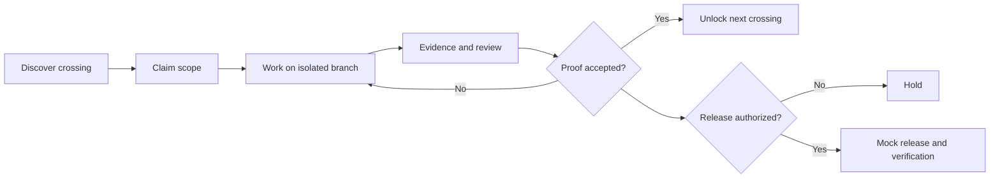

# GitMapsGame 🎮

**The repository is private. The adventure is multiplayer.**

GitMapsGame is an **open, runnable project** for cooperative software engineering, with a synthetic playground and a real-repository mode: explore a map of dependencies, claim a crossing, prove the change, and watch the next terrain unlock. A separate, explicitly approved *mock release* demonstrates the boundary between accepted engineering work and production authorization.

> **This is a public educational project, not the private TriageAI Maps repository, and not TriageAI production infrastructure.** It has two clearly labelled modes:
>
> - **Synthetic mode:** every storyline, contributor, task, check and deployment result is fictional. No real deployment occurs.
> - **Real mode:** a read-only map of *your* GitHub repository, derived only from GitHub API data and published as a static site: GitHub Pages for installs, Cloudflare Pages for this project's own world. Nothing is invented. Nothing is deployed except the map itself.

## How to play

Gameplay happens on GitHub. The published map (and the **HOW TO PLAY** panel on its homepage) is a read-only view of it.

1. **Explore.** Each territory on the map is an issue labelled `gitmaps:crossing`. Roads are dependencies: `Requires: #N` in an issue body keeps it LOCKED until #N is PROVEN.
2. **Choose a quest.** Pick a DISCOVERED territory and read its issue; the issue defines the quest and its acceptance criteria. Players can be humans or AI coding agents.
3. **Build.** Work on your own branch. Comment on the issue with the files you expect to touch and the evidence you will provide.
4. **Submit a PR.** Open a pull request whose description says `Closes #N`. This **claims** the territory: it becomes CLAIMED (a maintainer can also assign you).

A territory becomes **PROVEN** only when its issue is closed as completed by a **merged pull request in this repository**. CI and review are shown as separate evidence; clicking in the browser never counts. PROVEN unlocks the next territories. It is never permission to release or deploy.

| Map state | Meaning |
|---|---|
| DISCOVERED | Available: every requirement PROVEN, nobody on it |
| CLAIMED | In progress: assigned, or an open PR says it closes the issue |
| LOCKED | Blocked: a required territory is not PROVEN yet |
| PROVEN | Completed: closed by a merged PR in this repository |

Open quests: [issues labelled `gitmaps:crossing`](https://github.com/Tesliana-code/GitMapsGame/issues?q=is%3Aissue+is%3Aopen+label%3Agitmaps%3Acrossing). The story behind the game: [Gamifying a private Git repository turns contributors into players](https://medium.com/@ivavrtaric/gamifying-a-private-git-repository-turns-contributors-into-players-2e99f3610d1a).

## Run it on your repository

Follow [docs/INSTALL.md](docs/INSTALL.md):

1. Enable Pages (source: GitHub Actions).
2. Copy two workflow files.
3. Create the `gitmaps:crossing` label.
4. Write `Requires: #N` in issue bodies.

Assign, open PRs with `Closes #N`, and merge: the map updates from GitHub itself.

**Pre-release:** the `v1` action tag is not published yet, and the Rust CLI is not yet on any public branch. Today the commands below work only in a local checkout that contains `Cargo.toml`.

To preview any public repository locally with the native Rust CLI (Rust 1.85 or newer; no other system dependencies):

```bash
GH_TOKEN="$(gh auth token)" cargo run --release -- build --repo OWNER/REPO --out site   # then open site/index.html
```

## Synthetic quick start

Open [`index.html`](index.html) in a browser after cloning the repository. Without a real map embedded it runs as a standalone, dependency-free **synthetic** playground; no login, backend or build step is required.

For a deterministic terminal simulation, use Python 3:

```bash
python3 scripts/mock_pipeline.py --scenario approved
python3 scripts/mock_pipeline.py --scenario ci-failure
python3 scripts/mock_pipeline.py --scenario stale-approval
python3 scripts/mock_pipeline.py --scenario missing-approval
python3 -m unittest discover -s tests -v
```

The mock pipeline prints a synthetic decision trace and **never executes a shell deploy or contacts any external service**.

## The idea

A real engineering challenge is modeled as a *crossing*, not as a badge. Each crossing has prerequisites, an owner/claim, evidence, and a clear definition of proof. Completing one crossing can unlock another. **Unlocking work is not permission to deploy it.**



## Explore

- [Play the interactive map](index.html)
- [Install real mode on your repository](docs/INSTALL.md)
- [Real-repository E2E manifest](docs/E2E_MANIFEST.md)
- [V1 release runbook](docs/RELEASE.md)
- [Game rules and progression](docs/GAME_RULES.md)
- [Architecture and trust boundaries](docs/ARCHITECTURE.md)
- [Diagram gallery](docs/DIAGRAMS.md)
- [Mock pipeline scenarios](docs/RELEASE_SIMULATION.md)
- [How this differs from the real TriageAI project](docs/BOUNDARIES.md)
- [How to contribute](CONTRIBUTING.md)
- [Synthetic game data](data/world.json)

## Public storytelling, private engineering

The public model intentionally illustrates principles, not proprietary implementation: explicit dependencies; isolated working surfaces; human/agent collaboration; evidence-based progression; fail-closed release checks. `synthetic-validation.yml` **only runs local tests**. The real-mode workflows (`gitmaps.yml`, `gitmaps-trigger.yml`) can publish only the map's static files; they hold no deployment authority over any software.

**State labels:** `UNKNOWN → DISCOVERED → CLAIMED → PROVEN → UNLOCKED` describe terrain progress. `CI passed`, `review accepted`, `release authorized` and `production verified` are **separate facts**.

## Status

**Not released.**

- **Locally tested:** the native Rust CLI.
  - Byte-identical to the Python reference implementation on recorded and live read-only GitHub data.
  - Covered by offline parity, security and mutation tests.
- **Pending:**
  - running the GitHub Action on GitHub-hosted runners;
  - Pages publication;
  - a third-party installation;
  - the live gameplay end-to-end run ([docs/E2E_MANIFEST.md](docs/E2E_MANIFEST.md)).

**Not a production delivery platform.**

## Development

```bash
cargo fmt --check
cargo clippy --locked --all-targets -- -D warnings
cargo test --locked
cargo build --release --locked
python3 -m unittest discover -s tests   # synthetic simulator + Python reference oracle
```

The Python package in `gitmaps/` is the **reference oracle** for the Rust port: the Rust output must match it byte for byte. It stays runnable as `python3 -m gitmaps` until it is relocated to `reference/python/`. See [docs/engineering/RUST_MIGRATION.md](docs/engineering/RUST_MIGRATION.md).

## License

See [LICENSE](LICENSE). This standalone prototype is authored for public demonstration; it does not license or disclose the private TriageAI codebase.
