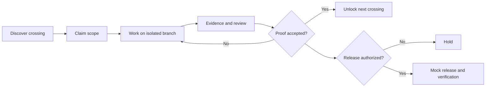

# GitMapsGame 🎮

**The repository is private. The adventure is multiplayer.**

GitMapsGame is an **open, synthetic, runnable reference project** for cooperative software engineering: explore a map of dependencies, claim a crossing, prove the change, and watch the next terrain unlock. A separate, explicitly approved *mock release* demonstrates the boundary between accepted engineering work and production authorization.

> **This is a public educational project, not the private TriageAI Maps repository, and not TriageAI production infrastructure.** It has two clearly labelled modes:
>
> - **Synthetic mode:** every storyline, contributor, task, check and deployment result is fictional. No real deployment occurs.
> - **Real mode:** a read-only map of *your* GitHub repository, derived only from GitHub API data and published to GitHub Pages. Nothing is invented. Nothing is deployed except the map itself.

## Run it on your repository

Follow [docs/INSTALL.md](docs/INSTALL.md). **Pre-release:** the `v1` action tag is not published yet, so only the local preview below works today.

1. Enable Pages (source: GitHub Actions).
2. Copy two workflow files.
3. Create the `gitmaps:crossing` label.
4. Write `Requires: #N` in issue bodies.

Assign, open PRs with `Closes #N`, and merge: the map updates from GitHub itself. To preview any public repository locally:

```bash
GH_TOKEN="$(gh auth token)" python3 -m gitmaps build --repo OWNER/REPO --out site   # open site/index.html
```

## Synthetic quick start

Open [`index.html`](index.html) in a browser after cloning the repository. Without a real map embedded it runs as a standalone, dependency-free **synthetic** playground; no login, backend or build step is required.

For a deterministic terminal simulation, use Python 3:

```bash
python3 scripts/mock_pipeline.py --scenario approved
python3 scripts/mock_pipeline.py --scenario ci-failure
python3 scripts/mock_pipeline.py --scenario stale-approval
python3 scripts/mock_pipeline.py --scenario missing-approval
python3 -m unittest discover -s tests -v
```

The mock pipeline prints a synthetic decision trace and **never executes a shell deploy or contacts any external service**.

## The idea

A real engineering challenge is modeled as a *crossing*, not as a badge. Each crossing has prerequisites, an owner/claim, evidence, and a clear definition of proof. Completing one crossing can unlock another. **Unlocking work is not permission to deploy it.**



## Explore

- [Play the interactive map](index.html)
- [Install real mode on your repository](docs/INSTALL.md)
- [Real-repository E2E manifest](docs/E2E_MANIFEST.md)
- [Game rules and progression](docs/GAME_RULES.md)
- [Architecture and trust boundaries](docs/ARCHITECTURE.md)
- [Diagram gallery](docs/DIAGRAMS.md)
- [Mock pipeline scenarios](docs/RELEASE_SIMULATION.md)
- [How this differs from the real TriageAI project](docs/BOUNDARIES.md)
- [How to contribute](CONTRIBUTING.md)
- [Synthetic game data](data/world.json)

## Public storytelling, private engineering

The public model intentionally illustrates principles, not proprietary implementation: explicit dependencies; isolated working surfaces; human/agent collaboration; evidence-based progression; fail-closed release checks. `synthetic-validation.yml` **only runs local tests**. The real-mode workflows (`gitmaps.yml`, `gitmaps-trigger.yml`) can publish only the read-only map to GitHub Pages; they hold no deployment authority over any software.

**State labels:** `UNKNOWN → DISCOVERED → CLAIMED → PROVEN → UNLOCKED` describe terrain progress. `CI passed`, `review accepted`, `release authorized` and `production verified` are **separate facts**.

## Status

Real mode V1 is implemented and tested offline against recorded GitHub API data. The live end-to-end run is pending; see [docs/E2E_MANIFEST.md](docs/E2E_MANIFEST.md). **Not a production delivery platform.**

## License

See [LICENSE](LICENSE). This standalone prototype is authored for public demonstration; it does not license or disclose the private TriageAI codebase.
