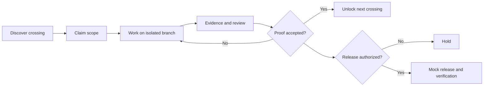

# GitMapsGame 🎮

**The repository is private. The adventure is multiplayer.**

GitMapsGame is an **open, synthetic, runnable reference project** for cooperative software engineering: explore a map of dependencies, claim a crossing, prove the change, and watch the next terrain unlock. A separate, explicitly approved *mock release* demonstrates the boundary between accepted engineering work and production authorization.

> **This is a public educational prototype, not the private TriageAI Maps repository, and not TriageAI production infrastructure.** All storylines, contributors, tasks, evidence, checks and deployment results are fictional. No real deployment occurs.

## Quick start

Open [`index.html`](index.html) in a browser after cloning the repository. It is a standalone, dependency-free interactive playground; no login, backend or build step is required.

For a deterministic terminal simulation, use Python 3:

```bash
python3 scripts/mock_pipeline.py --scenario approved
python3 scripts/mock_pipeline.py --scenario ci-failure
python3 scripts/mock_pipeline.py --scenario stale-approval
python3 scripts/mock_pipeline.py --scenario missing-approval
python3 -m unittest discover -s tests -v
```

The mock pipeline prints a synthetic decision trace and **never executes a shell deploy or contacts any external service**.

## The idea

A real engineering challenge is modeled as a *crossing*, not as a badge. Each crossing has prerequisites, an owner/claim, evidence, and a clear definition of proof. Completing one crossing can unlock another. **Unlocking work is not permission to deploy it.**



## Explore

- [Play the interactive map](index.html)
- [Game rules and progression](docs/GAME_RULES.md)
- [Architecture and trust boundaries](docs/ARCHITECTURE.md)
- [Diagram gallery](docs/DIAGRAMS.md)
- [Mock pipeline scenarios](docs/RELEASE_SIMULATION.md)
- [How this differs from the real TriageAI project](docs/BOUNDARIES.md)
- [How to contribute](CONTRIBUTING.md)
- [Synthetic game data](data/world.json)

## Public storytelling, private engineering

The public model intentionally illustrates principles, not proprietary implementation: explicit dependencies; isolated working surfaces; human/agent collaboration; evidence-based progression; fail-closed release checks. The sample GitHub workflow under `.github/workflows/` **only runs local tests** and cannot trigger a real deployment.

**State labels:** `UNKNOWN → DISCOVERED → CLAIMED → PROVEN → UNLOCKED` describe terrain progress. `CI passed`, `review accepted`, `release authorized` and `production verified` are **separate facts**.

## Status

Concept prototype for an upcoming technical article. **Not a production delivery platform.** The workflow and examples are demonstrative; any later real integration needs independent engineering and security review.

## License

See [LICENSE](LICENSE). This standalone prototype is authored for public demonstration; it does not license or disclose the private TriageAI codebase.
