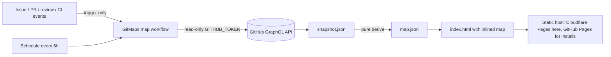
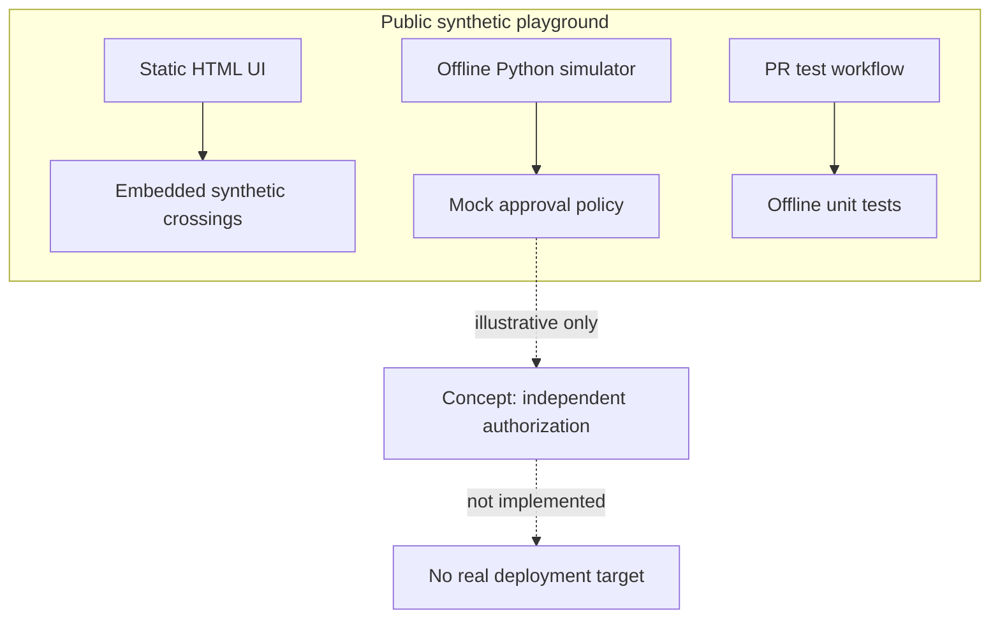

# GitMapsGame architecture

GitMapsGame has a **synthetic mode** (a static demo that cannot operate infrastructure) and a **real mode** (a read-only map of a GitHub repository). They share the visual design and nothing else.

## Real mode

1. **Authority:** the GitHub API snapshot is the only input. Event payloads are never read. An unchanged repository yields a byte-identical snapshot, because no fetch time is stored.
2. **Ingestion** (`src/fetch.rs`): crossing issues (paginated, at most 200), `Requires:` lines, assignees, linked PRs (paginated), the latest close event and its closer, PR reviews (paginated), and the head-commit CI rollup. Any list the API truncates is reported as an evidence gap.
3. **Derivation** (`src/derive.rs`): a pure function with the precedence INVALID > LOCKED > PROVEN > CLOSED_UNPROVEN > CLAIMED > DISCOVERED. Non-canonical snapshots are rejected.
4. **Rendering** (`src/render.rs`; `index.html` is compiled into the binary): the map is inlined into `index.html` with `<`, `>` and `&` escaped. The CSP allows exactly the one shipped script (sha256) and no network access. `map.json`, `snapshot.json` and `SHA256SUMS` are published next to it.
5. **Workflows:**
   - `gitmaps-trigger.yml` has no permissions and runs for PRs and reviews, including forks.
   - `gitmaps.yml` runs on the default branch:
     - the build job has read-only permissions and compiles the CLI with `cargo build --release --locked` in a step that has no token, from the action's own directory;
     - this repository's `publish` job has no GitHub token scopes, runs only on `main`, verifies `SHA256SUMS` and uploads to Cloudflare Pages with credentials held in the `cloudflare-pages` environment;
     - in the install example, the deploy job alone has `pages: write` and `id-token: write`.
   - No `pull_request_target`. PR code is never checked out. Actions are pinned by SHA.
6. **Publication guard:** private and internal repositories are refused unless explicitly overridden.
7. **Reference oracle:** the Python package `gitmaps/` implements the same pipeline. The Rust CLI must reproduce its output byte for byte (`tests/parity.rs`, `tests/site.rs`). It stays runnable until it is relocated to `reference/python/`.

Status: release candidate, locally tested. GitHub-hosted runs, Cloudflare publication and live gameplay are pending; see [RELEASE.md](RELEASE.md).

## Synthetic mode

## Trust boundaries

1. **World state:** browser-local ephemeral state only. Reload resets progress.
2. **Validation:** the Python script receives synthetic boolean inputs, returns a string, and invokes neither shell nor network.
3. **CI:** repository actions test mock behavior only. They cannot deploy anything.
4. **Release:** in-browser “approval” is a teaching device, not real founder authorization, a signature or a security boundary.
5. **Data:** invented names/IDs only; no customer information, internal TriageAI source, production URLs, tokens, secrets or configuration.

## Not implemented

Real mode V1 is a read-only view. It has no GitHub App, no server-side policy engine, no signed provenance, no release-authority verification and no deployment attestation. A real system must address replay, TOCTOU, RBAC, impersonation, event authenticity and durable history before accepting external claims.

## Distinguishing two kinds of progression

**Map progression:** the crossing proof makes a new area *playable*.

**Release progression:** independently authorized, validated software may be *shipped*.

One is not the other. The prototype renders both to teach this separation.
