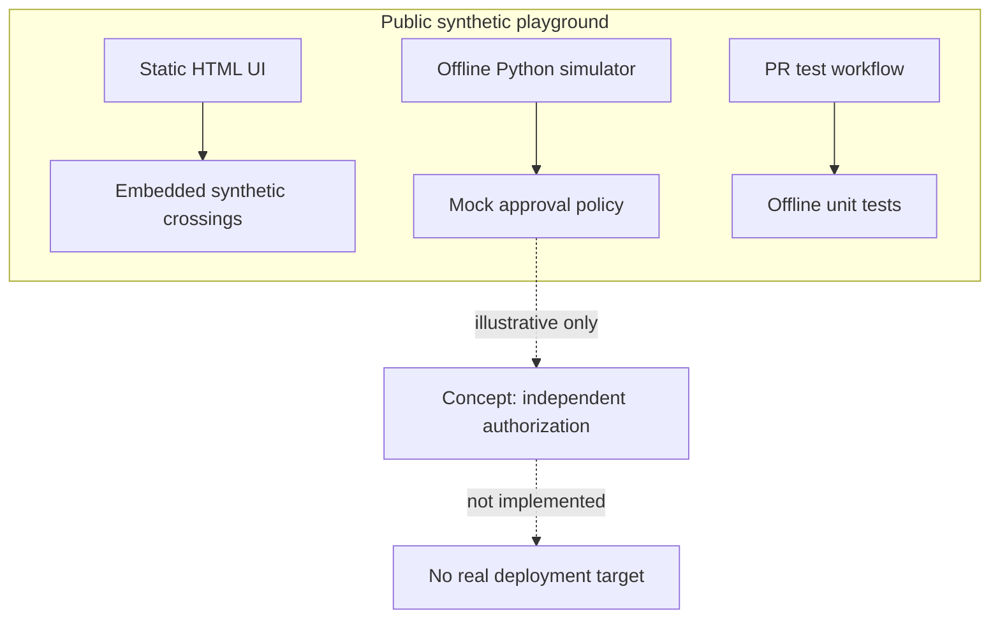

# GitMapsGame architecture

This prototype is static and intentionally cannot operate infrastructure.

## Trust boundaries

1. **World state:** browser-local ephemeral state only. Reload resets progress.
2. **Validation:** the Python script receives synthetic boolean inputs, returns a string, and invokes neither shell nor network.
3. **CI:** repository actions test mock behavior only. They cannot deploy anything.
4. **Release:** in-browser “approval” is a teaching device, not real founder authorization, a signature or a security boundary.
5. **Data:** invented names/IDs only; no customer information, internal TriageAI source, production URLs, tokens, secrets or configuration.

## Future architecture — proposal, not implemented

A hardened implementation could use a trusted GitHub App for PR/event ingestion; a server-side policy engine to evaluate the signed, reviewed provenance of a crossing; protected branches and independent release-authority verification; audit records; and explicit deployment attestation. **None of these exists in GitMapsGame V1.** A real system must address replay, TOCTOU, RBAC, impersonation, event authenticity and durable history before accepting external claims.

## Distinguishing two kinds of progression

**Map progression:** the crossing proof makes a new area *playable*.

**Release progression:** independently authorized, validated software may be *shipped*.

One is not the other. The prototype renders both to teach this separation.
