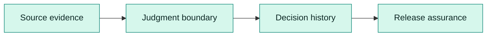
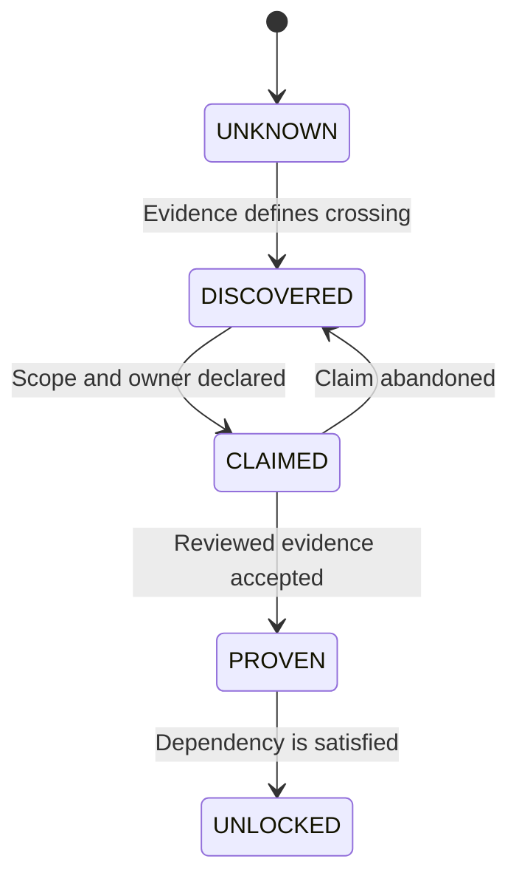
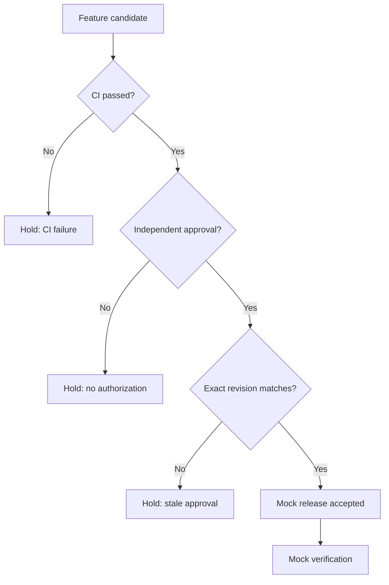
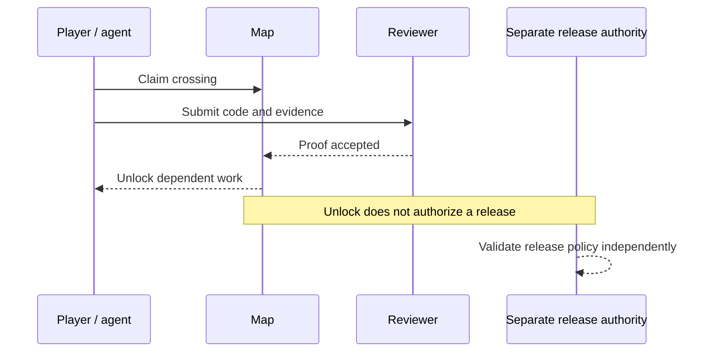

# Diagram gallery

These diagrams intentionally depict a **synthetic educational model**, not TriageAI deployment topology.

## 1. World map

## 2. Unlock conditions

## 3. Independent release gate

## 4. Contributors and authority

